# PHP2Shell: The Hartwell Breach
**Threat Hunt Write-Up · Shayquan "Ozzy" Osborne · Nov 2026**

Tools: Microsoft Defender Advanced Hunting (KQL) · Apache access/error logs · enriched HTTP (packet capture) · Sysmon for Linux · Syslog
📄 **[Full report with every screenshot (PDF)](PHP2Shell__The_Hartwell_Breach.pdf)**

---

## Summary
On Oct 23, 2026, attacker **192.168.1.100** scanned the Hartwell web server, exploited PHP's `session.upload_progress` to drop a web shell (`health-check.php`), ran hidden commands through an obfuscated header, stole WordPress DB credentials and user records, tried to disable monitoring, set up cron persistence from a RAM-only implant, and exfiltrated data through the shell. **No lateral movement was found.**

## Attack Timeline (UTC, Oct 23, 2026)
| Time | Event |
|---|---|
| 04:00–13:53 | Recon: rotating user agents, Nmap NSE, zgrab, curl, python-requests |
| 13:53–13:57 | Exploit: 8 multipart POST uploads with crafted session cookies (`session.upload_progress`) |
| 14:01 | Web shell `health-check.php` first requested |
| 14:13:55 | `auditctl -D` wipes audit rules |
| 14:14:01–07 | `systemctl stop sysmon` / `SplunkForwarder` (failed — www-data isn't root) |
| 14:14:39 | `base64 wp-config.php` (credential theft + exfil) |
| 14:15:15 | `SELECT * FROM wp_users \| base64` (user records exfil) |
| 14:15:49 | Implant staged at `/dev/shm/.cache-helper` |
| 14:19:26 | Last web shell command |

---

## Findings

### 1.1 — Attacker IP
**Answer:** `192.168.1.100`
```kql
HartwellApache_CL
| where OriginalTime between (datetime(2026-10-23T04:00:00Z) .. datetime(2026-10-23T16:00:00Z))
| summarize Requests = count() by SourceIP
| sort by Requests desc
```
192.168.1.120 had more requests, but it's the web server itself (local traffic and the lab's noise generator), so .100 is the outsider.
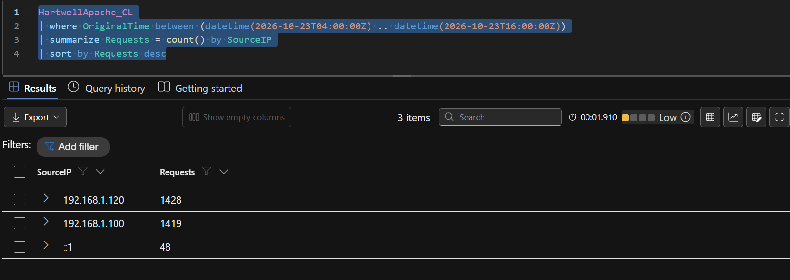

**ATT&CK:** T1595 – Active Scanning

### 1.2 — Reconnaissance Tooling
```kql
HartwellApache_CL
| where OriginalTime between (datetime(2026-10-23T04:00:00Z) .. datetime(2026-10-23T16:00:00Z))
| where SourceIP == "192.168.1.100"
| summarize Requests = count() by UserAgent
| sort by Requests desc
```
**Found:** Many browser user agents from one IP (Android, iPhone, iPad, Mac, Windows, Linux), plus tool signatures: curl, python-requests, zgrab, a fake Googlebot, and the Nmap Scripting Engine (93 requests).
**Means:** One person doesn't use a dozen devices — the attacker was rotating fake user agents to blend in. The Nmap signature shows automated scanning.
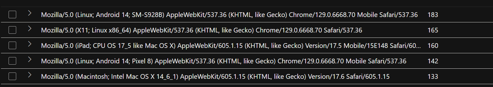

**ATT&CK:** T1595 – Active Scanning

### 2.1 — Exploited PHP Feature
**Answer:** `session.upload_progress`
- **Error log:** three warnings repeat as a set, 25 times each — illegal session ID, failed to read session data, failed to write session data.
- **Enriched HTTP log:** between 13:53 and 13:57 UTC the attacker sent multipart uploads to the homepage with crafted session cookies that escalate in name (`recon_` → `exploit_` → `ph2sh_` → `pwned_`), chunked transfer encoding to hold the upload open, fake `X-Forwarded-For` IPs, and a boundary named `0x4148php2shell`.

**Means:** The underscores are illegal session-ID characters (hence the warnings). Uploading with a crafted session cookie while holding the upload open abuses PHP's upload-progress feature to write attacker-controlled data into a session file.
**Lesson:** The warning named `session.save_path`, but that was the symptom, not the cause. The request data showed the real feature.
**ATT&CK:** T1190 – Exploit Public-Facing Application

### 2.2 — Exploit Delivery
**Answer:** `POST, multipart/form-data`

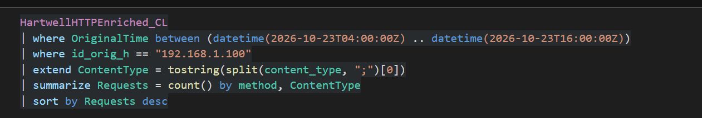


The attacker sent 430 normal GET page visits to blend in, then slipped in 8 POST file uploads carrying fake session cookies. Those uploads were the exploit.
**ATT&CK:** T1190 – Exploit Public-Facing Application

### 2.3 — Web Shell
**Answer:** `health-check.php`

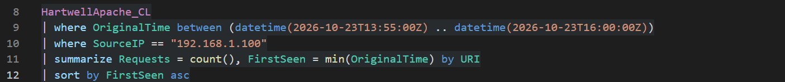

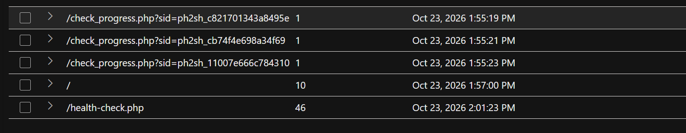
First requested at 14:01, ~6 minutes after the exploit, and requested 46 times. The name was chosen to look like routine monitoring.
**ATT&CK:** T1505.003 – Server Software Component: Web Shell

### 3.1 — Compromised Account
**Answer:** `www-data`

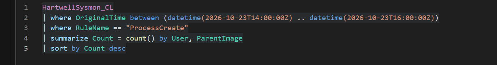

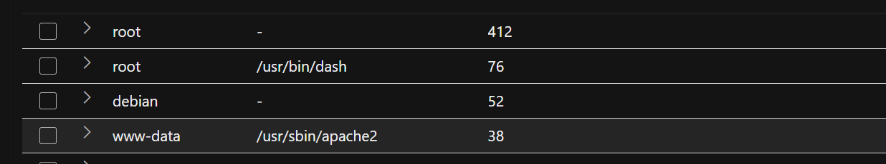
Sysmon ProcessCreate events grouped by User and ParentImage: root runs system housekeeping, but www-data (the Apache service account) was spawning programs from the web server — which it should never do.
**ATT&CK:** T1059.004 – Command and Scripting Interpreter: Unix Shell

### 3.2 — Command Channel
**Answer:** `X-HMG-Debug` header

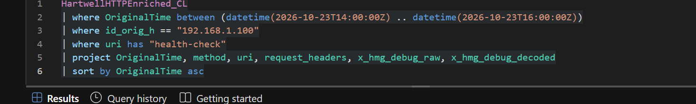

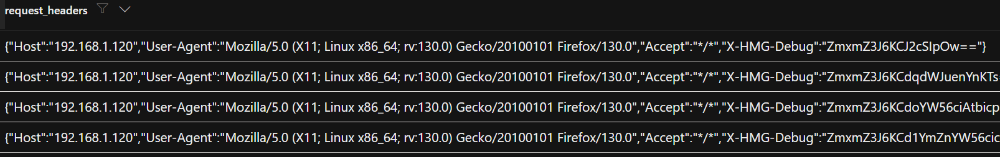
Commands were hidden in a custom header instead of the URL, because the Apache log records URLs but not headers. Only the packet capture revealed them.
**ATT&CK:** T1027 – Obfuscated Files or Information

### 3.3 — Encoding
**Answer:** ROT13, then base64

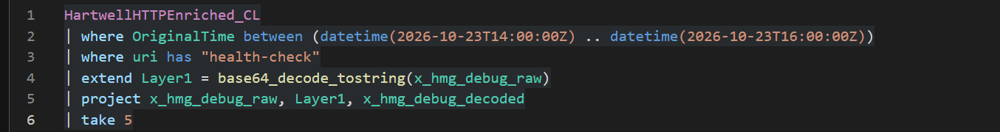

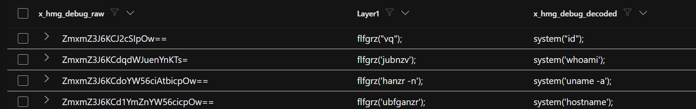
Spotted base64 from the `==` padding, decoded it, then saw letters shifted by 13.
**ATT&CK:** T1027 – Obfuscated Files or Information

### 4.1 — Network Discovery
**Answer:** `ip addr`, `ip neigh`, `ss`

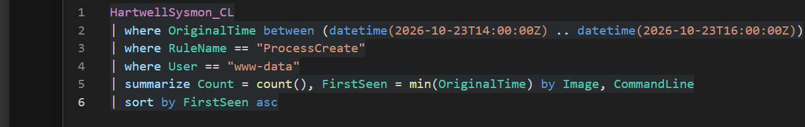


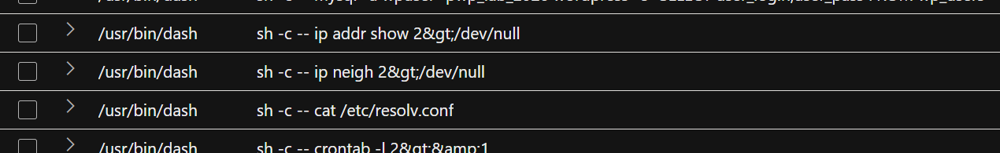
- `ip addr show` — this machine's address
- `ip neigh` — other machines it has talked to
- `ss -tlnp` — services listening on this machine

**ATT&CK:** T1016 – System Network Configuration Discovery; T1049 – System Network Connections Discovery

### 4.2 — Security Software Discovery
**Answer:** sysmon, auditd, SplunkForwarder


Checked whether three security tools were running, right after trying to stop them.
**ATT&CK:** T1518.001 – Software Discovery: Security Software Discovery

### 5.1 — Credential Access
**Answer:** `/var/www/html/wp-config.php`

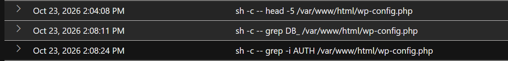
Read several times (`head`, `grep DB_`, `grep AUTH`, then `base64` to copy the whole file) to get the WordPress database credentials.
**ATT&CK:** T1552.001 – Unsecured Credentials: Credentials In Files

### 6.1 — Defense Evasion
**Answer:** sysmon, auditd, SplunkForwarder

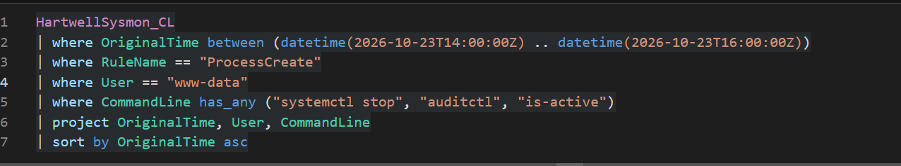


Ran `systemctl stop sysmon` (14:14:01) and `systemctl stop SplunkForwarder` (14:14:07), wiped auditd's rules with `auditctl -D` (14:13:55), then ran `systemctl is-active` to confirm. The syslog stops at 15:07–15:10 were apache2 and rsyslog from systemd an hour later, so not the attacker. The stops failed: www-data isn't root, so the services kept running.
**ATT&CK:** T1562.001 – Impair Defenses: Disable or Modify Tools

### 6.2 — Did It Work?
**No.** The attacker operated as the unprivileged www-data account, which lacks the root permissions needed to stop system monitoring services.

### 7.1 — Persistence
**Answer:** crontab

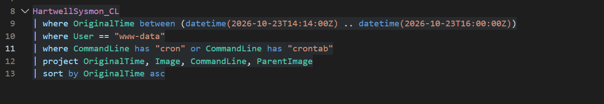


```
*/5 * * * * /dev/shm/.cache-helper 300
```
Every 5 minutes, forever — an alarm clock that re-runs the implant, so a reboot or a killed process won't kick the attacker out.
**ATT&CK:** T1053.003 – Scheduled Task/Job: Cron

### 7.2 — Hidden Implant
**Answer:** `/dev/shm/.cache-helper`

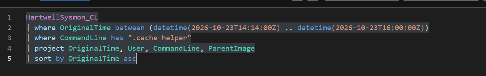

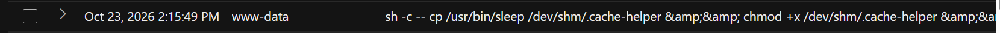
At 14:15:49 UTC, www-data ran `cp /usr/bin/sleep /dev/shm/.cache-helper && chmod +x /dev/shm/.cache-helper && ls -la /dev/shm/.cache-helper` — copy a harmless binary into place as a stand-in implant, make it executable, verify it's there. (`&amp;&amp;` in the log is just `&&` HTML-encoded.)

**Why the location matters:**
- `/dev/shm` lives in RAM — wiped on reboot, absent from a disk image.
- The leading dot hides it from a normal `ls`.
- "cache-helper" blends in with normal system files.
- **Responder takeaway:** capture memory / copy `/dev/shm` *before* rebooting.

**ATT&CK:** T1564.001 – Hidden Files and Directories; T1036.005 – Masquerading: Match Legitimate Name or Location

### 8.1 — Exfiltration
**Answer:** Encoded with base64 and sent back through the web shell's HTTP responses.

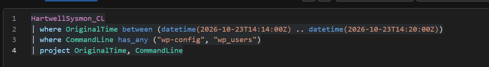

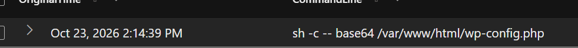
- `base64 /var/www/html/wp-config.php` and `SELECT * FROM wp_users | base64` — both dumps were base64-encoded and returned in the shell's responses.
- NetworkConnect rows show only apache2 — no curl, wget, or nc, and no new IPs. The data left through the shell itself.

**ATT&CK:** T1041 – Exfiltration Over C2 Channel; T1132.001 – Data Encoding: Standard Encoding

### 8.2 — Lateral Movement Check
**Answer:** No evidence of lateral movement.
```kql
HartwellSysmon_CL
| where OriginalTime between (datetime(2026-10-23T14:14:00Z) .. datetime(2026-10-23T16:00:00Z))
| where CommandLine has_any ("192.168.1.", "ssh", "nmap", "ping", "scp", "smb", "mysql -h")
| summarize count() by User
```
- 368 matching rows, **0 from www-data** (the attacker's account).
- 363 were root: the lab's noise generator sending fake visitor traffic (Googlebot, bingbot, wp-cron).
- 5 were debian: an analyst grepping logs and running tcpdump.
- Only .120 (the web server) and .100 (the attacker) appear — no other 192.168.1.x host.

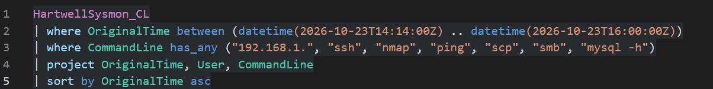

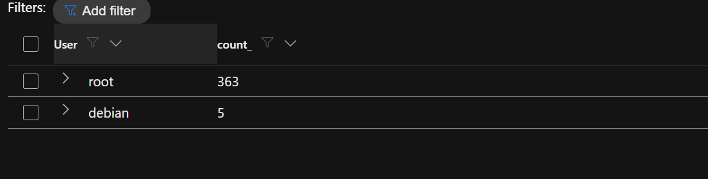

**ATT&CK:** TA0008 Lateral Movement — checked, not observed.

---

## MITRE ATT&CK Summary
| Tactic | Technique |
|---|---|
| Reconnaissance | T1595 Active Scanning |
| Initial Access | T1190 Exploit Public-Facing Application |
| Persistence | T1505.003 Web Shell · T1053.003 Cron |
| Execution | T1059.004 Unix Shell |
| Defense Evasion | T1027 Obfuscation · T1562.001 Impair Defenses · T1564.001 Hidden Files · T1036.005 Masquerading |
| Discovery | T1016 · T1049 · T1518.001 |
| Credential Access | T1552.001 Credentials In Files |
| Exfiltration | T1041 Over C2 Channel · T1132.001 Standard Encoding |
| Lateral Movement | Not observed |

## Recommendations
1. Patch PHP and disable `session.upload_progress` if not needed.
2. Remove `health-check.php`, kill the cron entry, and delete `/dev/shm/.cache-helper` (after capturing memory).
3. Rotate the WordPress DB credentials and force password resets for all `wp_users`.
4. Alert on `www-data` spawning shells, and log custom HTTP headers at the proxy/WAF.
5. Block 192.168.1.100.

---
